# عين · Eyn — Design Trainer

تطبيق أندرويد لتعليم التصميم الغرافيكي: «درّب عينك، صمّم بثقة».
An Android app that teaches graphic design, plus a builder for ready-made UI blocks and templates.

**Kotlin · Jetpack Compose · Material 3 · Arabic (RTL) & English · Auto / light / dark theme**

📦 Ready-to-install APK: [`release/eyn-1.3.1.apk`](release/eyn-1.3.1.apk)

| Home | Challenge | Lesson | Studio | Page builder | Canvas editor |
|---|---|---|---|---|---|
| 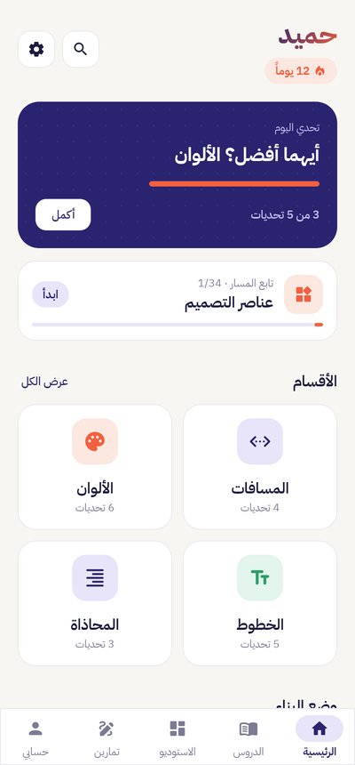 | 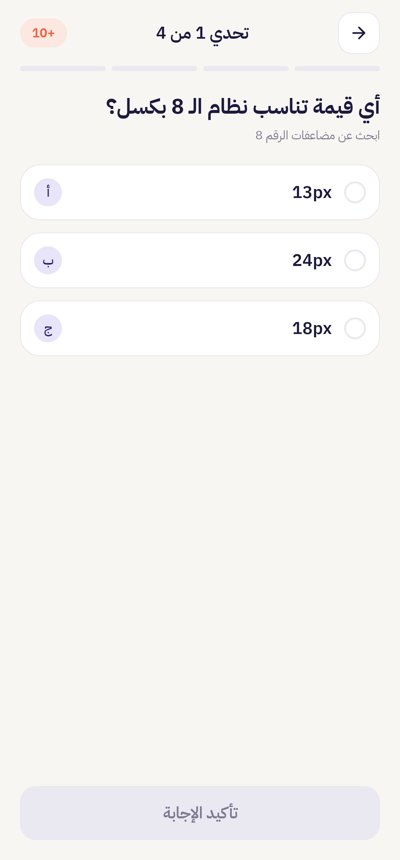 | 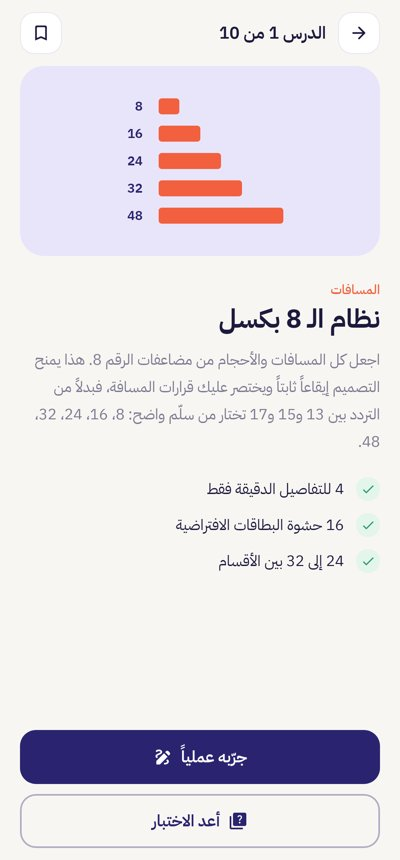 | 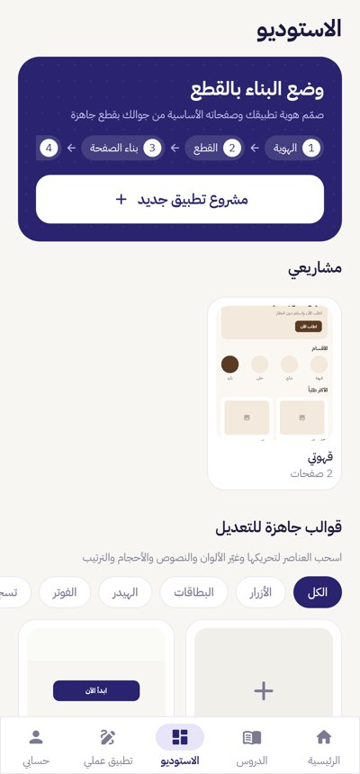 | 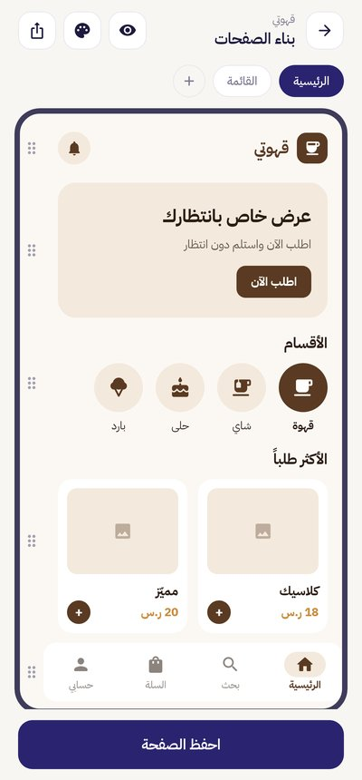 | 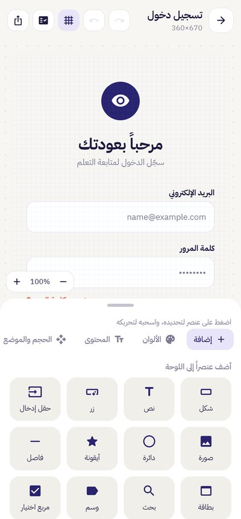 |

| Identity | Block library | Export | Contrast | Dark | English |
|---|---|---|---|---|---|
| 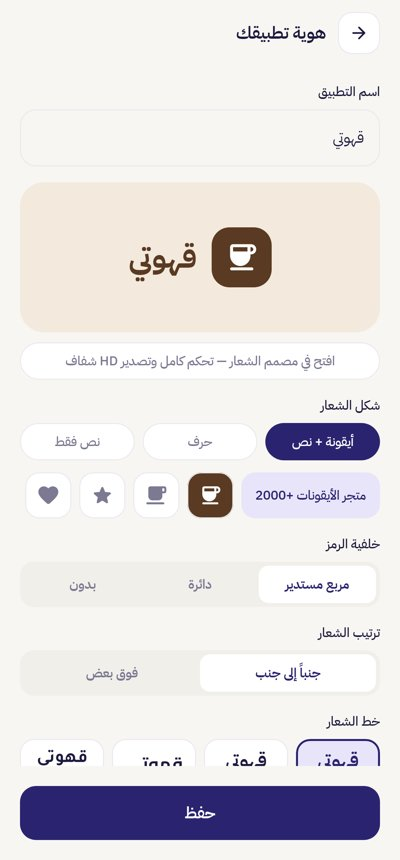 | 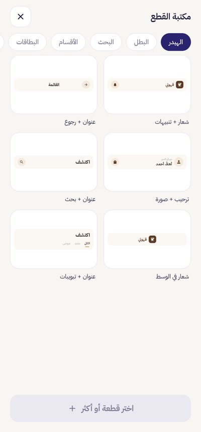 | 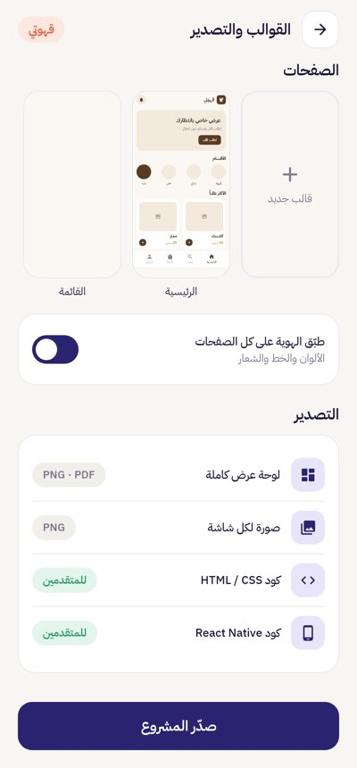 | 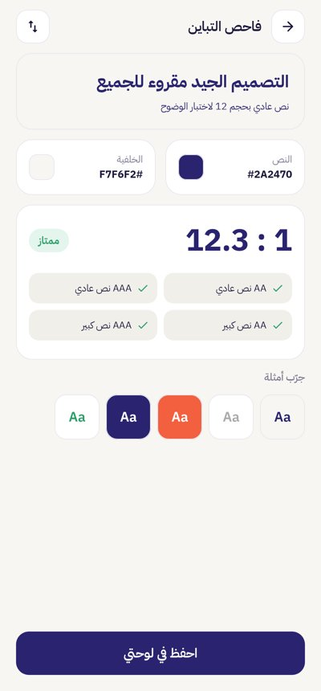 | 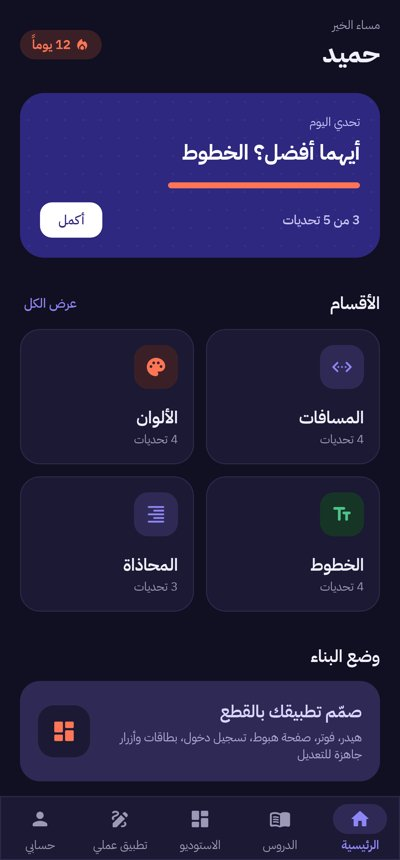 | 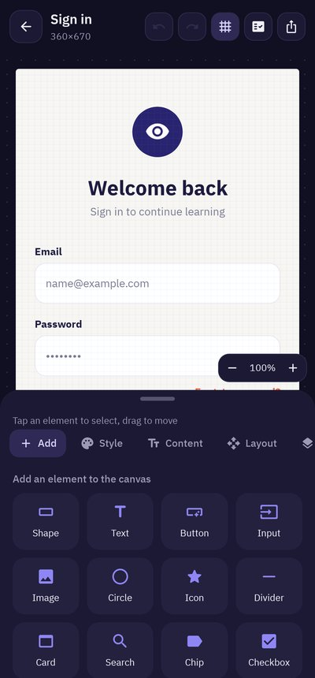 |

## الميزات · Features

### التعلّم · Learning
| Learning path | Spacing drills |
|---|---|
| 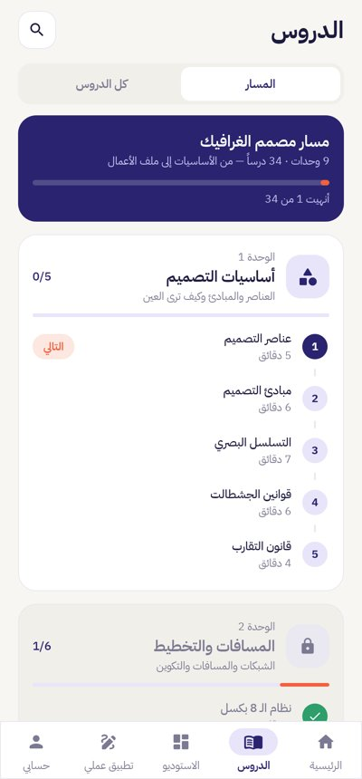 | 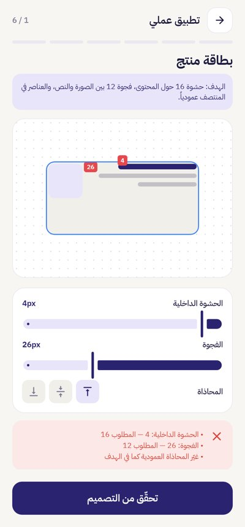 |

- **A complete graphic-design path**: 9 units, 34 lessons, unlocked unit by unit:
  1. Foundations: elements, principles, hierarchy, Gestalt, proximity
  2. Space & layout: 8px grid, white space, alignment, grids & columns, composition / rule of thirds, balance
  3. Color: color wheel & harmony, 60-30-10, contrast, color psychology, RGB/CMYK
  4. Typography: letter anatomy, Arabic type, type scale, pairing, readability
  5. Images: photos & cropping, icons, raster vs vector
  6. Identity: logo types, designing a logo step by step, brand guidelines
  7. Interfaces: UX basics, components & states, accessibility
  8. Print: preparing for print (CMYK, 300 dpi, bleed), sizes & formats
  9. Going pro: the design process, building a portfolio
- **Home**: greeting, day streak, a daily challenge of 5 questions, "continue the path", and sections.
- **"Which is better?" challenges** with an explanation after each answer. After a lesson quiz, "Next lesson" takes you straight on.
- **Practice tools**:
  - **6 different spacing drills**: product card, icon button, vertical card, list, form field, hero section.
  - WCAG contrast checker.
  - Font lab.
- **Profile and settings**: level, points, accuracy, streak, weekly activity and badges; theme (auto/light/dark), language, name, reset progress.

### وضع البناء بالقطع · Block build mode (screens 11–15)
1. **Identity**:
   - app name, logo (icon + text / letter / text only) with a **2,100+ icon store**
   - mark background (rounded / circle / none), side-by-side or stacked layout
   - **19 Arabic & Latin fonts** for the logo, name size, letter spacing, tagline
   - preset palettes or **your own colors** (with a contrast check)
   - **Open in logo designer** for full control and transparent HD export
2. **Block library**: header, hero, search, categories, cards, lists, text, forms, buttons, footer.
3. **Page builder**:
   - drag-to-reorder and labeled Up/Down buttons
   - **footers pinned to the bottom of the page**
   - a handle under the phone frame to **resize the page height**
   - multiple pages, preview mode
4. **Edit block** (the live preview stays pinned at the top):
   - text, variant, background, alignment, spacing, radius
   - **width %, button / field / image height, text size, minimum height, pin to bottom, a photo**
   - **editable tabs, rows and categories**: name, icon, add or remove, and the active tab per page
5. **Export**:
   - a **presentation board**: one image with the identity header (logo, app icon, palette with HEX codes, typeface, icon style) and every page in a phone frame, 4 per row, numbered and named
   - a PNG per page, HTML/CSS and React Native code

### القوالب الحرة · Freeform templates
Ready templates: buttons, cards, headers, footers, login/sign-up, landing pages and pricing. Or start from a blank canvas (phone, post, story, cover, A4).

| All elements | Layout | Style | Content |
|---|---|---|---|
| 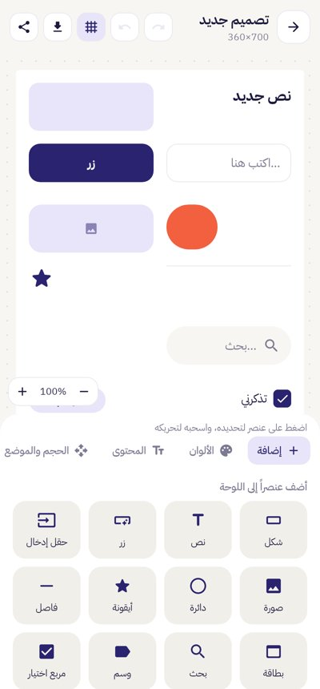 | 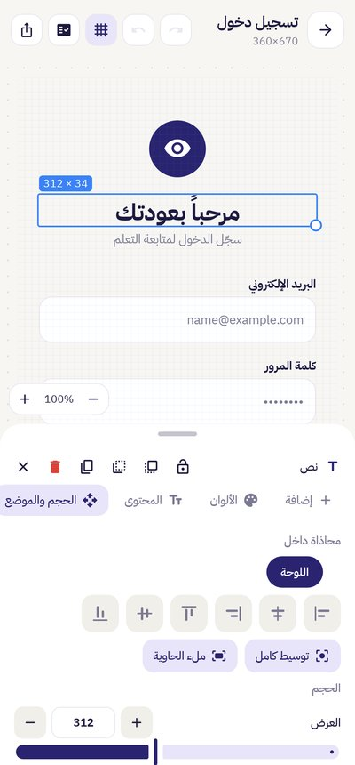 | 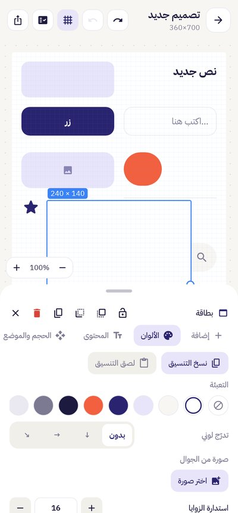 | 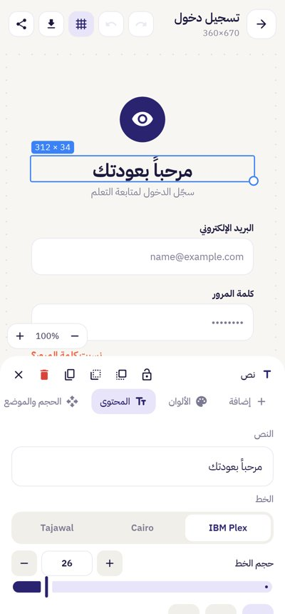 |

- **17 elements**: shape, card, text, button, chip, input, search bar, image, avatar, circle, icon, divider, checkbox, toggle, slider, progress bar, star rating.
- **Precise controls**: − / + steppers (hold to repeat) with an editable value for width, height, X, Y, rotation, font size, padding, radius, border, shadow, opacity and more, plus a slider for coarse moves.
- **Alignment**: drag snaps to the canvas and to other elements' edges and centers with pink guides. One tap aligns or **centers an element inside the element beneath it** (or the canvas), or makes it fill that container.
- **Content and text**: font (IBM Plex / Cairo / Tajawal), bold, italic, underline, horizontal and vertical alignment, horizontal/vertical padding, line height, letter spacing.
- **Style**: fill, gradient (3 directions), text/icon color, border, corner radius, shadow, opacity, copy/paste style.
- **Real photos** from the phone (system photo picker, no permission needed) inside images, avatars, shapes, cards, buttons and the canvas background, with fill/fit modes.
- **All 2,100+ Material icons** with search in Arabic and English, in **5 styles**: solid, outlined, rounded, sharp and two-tone (per element, and per project in the identity screen).
- Rotation, lock, show/hide, layers, z-order (forward, backward, to front, to back), duplicate, undo/redo, zoom.
- The properties panel stays above the keyboard while you type.
- **Background removal** from photos (on-device, ML Kit), then a new color, gradient or photo behind the subject.
- **Design review**: a score out of 100 with a verdict ("ready to approve" / "needs small touches" / "needs work"), notes on contrast, font size, font and color count, the 4/8 grid, margins, touch targets, near-miss alignment and overlapping text, plus one-tap fixes.
- **Logo templates** and **19 fonts** (IBM Plex, Cairo, Tajawal, Almarai, Amiri, Aref Ruqaa, Changa, El Messiri, Lalezar, Lemonada, Marhey, Rakkas, Reem Kufi, Poppins, Montserrat, Playfair, Bebas Neue, Pacifico, Lobster).
- A handle on the properties panel to hide it and see the full canvas. A grid appears when snapping is on.
- **Export**: PNG or JPG, at screen resolution, HD 2K or 4K, with or without a transparent background. Save to the gallery or share.

Arabic templates are mirrored automatically for right-to-left reading.

## البناء · Build

Requires JDK 17+ and the Android SDK (compileSdk 35, minSdk 26).

```bash
./gradlew assembleDebug        # app/build/outputs/apk/debug/app-debug.apk
./gradlew assembleRelease      # shrunk with R8, signed with the debug key — use your own keystore for Play
./gradlew testDebugUnitTest    # renders every screen headlessly (Robolectric) to app/build/screens/
```

## البنية · Structure

```
app/src/main/java/com/eyn/designtrainer/
├─ data/        AppData model, ViewModel (in-memory state persisted to DataStore), lessons & questions
├─ i18n/        Arabic/English strings helper
├─ ui/          navigation, theme (colors/type/animated dark mode), components, learning screens
└─ builder/     freeform canvas (templates, renderer, editor), block builder (identity, library,
                page builder, export), code generation, PNG/PDF export
```

Fonts: all bundled fonts are from Google Fonts under the SIL Open Font License; Material Icons under Apache 2.0.
